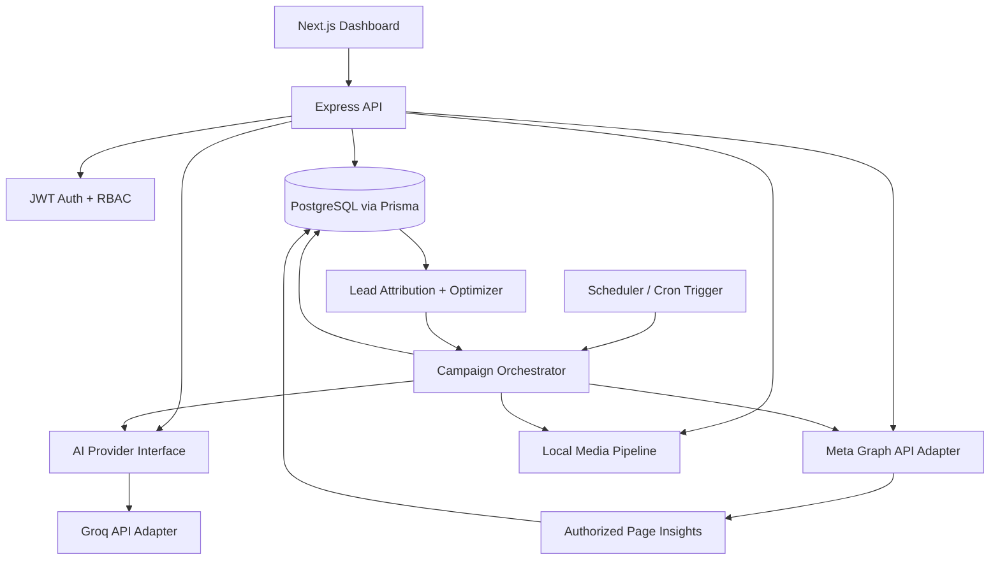

# Architecture — TutorLink AI Marketing Manager

## 1. System overview
A modular monorepo with a Next.js dashboard, Express API, Prisma/PostgreSQL persistence, a provider-neutral AI layer, Meta API adapter, local media pipeline, and scheduled orchestration.

## 2. Workspace layout
- `apps/web`: Next.js App Router, TypeScript, Tailwind, shadcn/ui, TanStack Query.
- `apps/api`: Express, TypeScript, Prisma, PostgreSQL, JWT, Zod.
- `packages/shared`: shared types, schemas, API contracts (introduced in implementation phase).
- `docs`: product, architecture, design, engineering rules, delivery phases, persistent project memory.

## 3. Backend modules
- `auth`: sign-in, password hashing, JWT issuance/verification, session policy.
- `business-profile`: trusted facts, service areas, brand assets, forbidden claims.
- `integrations/meta`: OAuth/token configuration, Page identity, publishing, insights, permission checks.
- `analytics`: normalize metrics and retain time windows.
- `leads`: lead intake/import, qualification status, reasons, human correction, booking outcome.
- `content`: campaign briefs, captions, hashtags, scripts, assets, validation.
- `media`: local image/layout rendering, TTS and FFmpeg adapters.
- `campaigns`: strategy, experiments, cadence, content queue.
- `optimizer`: diagnose outcomes, propose hypotheses, choose tests, evaluate results.
- `scheduler`: idempotent scheduled job entry points; not an always-on in-memory timer.
- `audit`: record consequential autonomous decisions and actions.
- `providers/ai`: provider-neutral interface with a Groq free-tier adapter and same-provider fallback model.
- `shared`: error types, config, logging, validation.

## 4. Data flow
1. Scheduler starts a bounded orchestration run.
2. Run obtains a PostgreSQL-backed lock/idempotency key.
3. Meta adapter fetches only authorized Page posts/insights.
4. Lead module loads new leads and confirmed bookings.
5. Attribution module associates leads with content where supported and marks uncertain attribution explicitly.
6. Optimizer produces a bounded decision with evidence, confidence, expected outcome, and risk.
7. Content agent generates Bangla content from trusted business facts.
8. Validators check factual claims, brand assets, duplication, policy, and prohibited behavior.
9. Publisher dry-runs or publishes through authorized official endpoints.
10. Metrics, decision, experiment, and publish result are persisted.
11. Next run evaluates prior experiments after an appropriate observation window.

## 5. AI interface
Use an interface such as:
- `generateStructured<T>(task, schema, context)`
- `classifyLead(message, trustedBusinessFacts)`
- `diagnosePerformance(metrics, leadOutcomes)`
- `proposeExperiment(history, constraints)`

The interface must expose provider/model identity, timeout, token/resource limits, and errors. Never let model output directly execute arbitrary code or arbitrary API calls. Parse against schemas and pass proposed actions through deterministic policy checks.

### Provider policy
- Default provider: GroqCloud free tier, primary `openai/gpt-oss-120b`, fallback `openai/gpt-oss-20b`. A separate autonomous strategy planner uses saved lead outcomes, linked content metrics, Page insight snapshots, and anti-repetition rules to choose topic, format, angle, and visual style. The LLM produces Bangla copy/scripts; deterministic policy gates select cadence and the Meta publishing adapter uploads a photo or rendered Reel when live mode and safety settings permit it.
- Ollama and local model runtimes are out of scope because deployment targets Vercel/cloud hosting.
- Keep provider/model configurable through server-only environment variables.
- Treat free-tier quota and availability as limited; enforce application-level usage limits and stop when the quota is exhausted.
- No fallback to a paid endpoint. Missing configuration means safe no-op / deterministic templates.
- Retry transient provider/network failures with bounded exponential backoff and jitter. Quota exhaustion, credentials, permissions, and invalid model configuration require intervention rather than repeated calls.
- The default same-provider fallback model is `openai/gpt-oss-20b`; it may be used after a transient primary failure or model-specific quota exhaustion. No paid endpoint is selected automatically.
- Benchmark Bangla content, JSON/schema adherence, factual grounding, and marketing usefulness before enabling autonomy.
- Free-tier prompts may be handled under provider-specific data-use terms; do not send secrets or unnecessary personal lead data to the model.

## 6. Meta integration
- Use official Meta Graph API only.
- Store Page access tokens server-side; never send them to the frontend.
- Keep Graph API version configurable.
- Check granted scopes and feature availability before each capability.
- Read-only analysis should work independently from publishing permission where possible.
- Publishing starts in `DRY_RUN`; live mode requires an explicit server-side environment setting and a successful preflight.
- Respect API rate limits, Page access, content formats, and Meta policies.
- Do not scrape private groups, members, or non-public user data.
- API access does not provide a precise list of “parents who need tutors”; audience relevance is inferred from content performance and voluntary leads.

## 7. Scheduler and deployment
- Interactive and daily draft generation is persisted in PostgreSQL `JobRun` records before acknowledgement. The local API runs a short polling worker; production uses a protected Vercel Cron endpoint. Neither depends on an in-memory timer for durable state.
- Workers claim jobs using PostgreSQL `FOR UPDATE SKIP LOCKED`, bounded leases, attempt limits, and stale-lease recovery. A content draft and the `COMPLETED` state are committed in one transaction; generated text is retained between asset retries.
- `RETRY_WAIT` jobs carry their next attempt time and safe error category. `NEEDS_ATTENTION` records stop retries for quota, credential, permission, and configuration blockers.
- The daily campaign pipeline evaluates cadence, creates content, renders a PNG/MP4, and publishes via Meta Graph API when live mode and server safety settings allow it. Ambiguous publish failures are not blindly retried.
- Vercel Cron is daily in the supplied configuration; the FFmpeg binary is bundled for bounded serverless Reel rendering.
- Check current plan terms, commercial use restrictions, cron frequency, timeout, and storage limits before selecting a host.
- Local media rendering is preferred for heavy FFmpeg work; for hosted operation use only a genuinely permitted free worker/service or keep media production as a separate local task.
- Every job has a lease, idempotency key, bounded attempts/runtime, safe retry policy, and an authenticated status/manual-retry API.
- Do not claim 24/7 autonomy until the scheduler, storage, and hosting are proven.

## 8. Security
- JWT secret is server-only and high entropy.
- Hash passwords with Argon2id or bcrypt using appropriate parameters.
- Validate inputs using Zod.
- Use secure headers, rate limiting, strict CORS, and request size limits.
- Encrypt or otherwise tightly protect long-lived integration tokens; at minimum restrict database access and never log tokens.
- Redact secrets from errors/logs.
- Audit authentication, integration changes, publishing, pause/resume, and optimizer actions.
- Keep `.env` out of Git; use `.env.example` placeholders.
- Treat credentials pasted into chat or source control as compromised and rotate them.
- Separate human authorization from AI decision-making.

## 9. Reliability
- Use database transactions for campaign state changes.
- Use unique idempotency keys for publication attempts.
- Retries only for transient errors; do not retry permanent permission or validation failures indefinitely.
- Dead-letter persistent failures and surface them to the dashboard.
- Keep `globalPause` and `publishingEnabled` flags in persistent configuration.
- On uncertainty, pause publishing and continue read-only analysis.

## Agent Mode Control and Human Takeover

Implement Agent Mode as a persisted, server-authoritative control (for example, `agentModeEnabled` scoped to the workspace/account). The dashboard toggle calls an authenticated API endpoint; all workers, schedulers, publishing pipelines, and messaging handlers must check the current mode immediately before executing any side effect. A UI-only toggle is not sufficient.

When mode is OFF, reject or pause new autonomous jobs and scheduled executions. Cancel in-flight work when supported; otherwise report its status and prevent subsequent steps where possible. Keep drafts and queue records intact. The backend must default to OFF if the mode cannot be read, and startup must load/verify the mode before workers process jobs. Turning ON requires an explicit authorized user action. Record actor, timestamp, previous state, new state, and relevant job outcomes in an audit log.

## Implemented modular scaffolding (current ZIP)
- Frontend navigation metadata lives in `apps/web/src/lib/navigation.ts`; the shared dashboard frame lives in `apps/web/src/components/layout/dashboard-shell.tsx`.
- Overview UI lives in `apps/web/src/components/dashboard/overview-page.tsx`; route module scaffolding is in `apps/web/src/components/dashboard/section-page.tsx`; App Router maps `/page-analyzer`, `/strategy-lab`, `/content-studio`, `/publishing-calendar`, `/qualified-leads`, `/learning-log`, `/settings`, and `/documentation` through `apps/web/src/app/[section]/page.tsx`.
- Backend bootstrapping is separated into `apps/api/src/server.ts` and `apps/api/src/app.ts`; system endpoints are in `apps/api/src/routes/system.routes.ts` and `apps/api/src/controllers/system.controller.ts`.
- Workspace modules include content generation, Meta insights import, lead storage, the autonomous campaign runner, publishing endpoints, and signed inbound webhook ingestion. External integrations still require real staging verification and valid Meta permissions.

## Scheduled creative generation
The API exposes `GET /api/cron/content-generation`, protected by constant-time comparison of the `Authorization: Bearer $CRON_SECRET` header. `apps/api/vercel.json` requests a daily Vercel Cron run. The automation service checks `SystemSetting` for global pause and Agent Mode, respects recent/future posts and qualified-lead outcomes, applies saved owner guidance, selects a non-recent topic/format, calls the configured text generator, creates a branded asset, and publishes through the Meta adapter when live mode is enabled. Scheduled content is published when due. Every decision and outcome is audited.

## Meta publish and inbound webhook modules
- `modules/meta/publishing.service.ts` owns publish preflight, publish-state claim, PNG conversion, FFmpeg Reel rendering, photo/Reel Graph API upload, final ContentItem status, and audit events. A failed/ambiguous response is not automatically retried to avoid duplicates.
- `modules/meta/webhook-security.ts` validates Meta subscription challenge and HMAC signature over the raw request body. `modules/meta/webhook.service.ts` deduplicates message/comment event IDs and stores inbound leads in NEW state. It does not send replies or mark leads qualified.
- `MetaWebhookEvent` and `ContentStatus.PUBLISHING` require additive migrations. Existing database migration drift must be reconciled before deployment.
- Messenger URL is verified configuration (`META_MESSENGER_URL`); every caption gets a clickable link. The API does not promise an unavailable native per-post CTA button.
